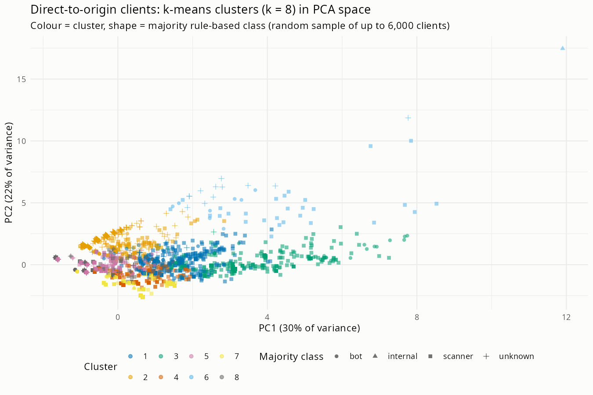

# Cluster validation of the rule-based client classes (KAP-69)

Generated by `analysis/cluster_validation.R`. Aggregates only.

## Data

- Direct-to-origin requests (`via_cloudflare == FALSE`): 153,792 of 395,121 (38.9%).
- Clients (distinct hashed addresses) in those requests: 4,662.
- Features (scaled to mean 0, sd 1 before clustering): log requests, active days, share 4xx, share probe requests, distinct-path ratio, share without user agent, log mean requests per active hour, share at night (00-06 UTC).
- `majority_class` (most common `client_class` of a client's requests) is **not** used for clustering; it is only the label we compare with.

Clients by majority class:

| majority_class | Freq |
|---|---|
| bot | 561 |
| internal | 2 |
| scanner | 2826 |
| unknown | 1273 |

Feature means by majority class (unscaled):

| majority_class | clients | requests_per_client | active_days | share_4xx | share_probe | distinct_paths_ratio | share_no_ua | requests_per_active_hour | share_night |
|---|---|---|---|---|---|---|---|---|---|
| bot | 561 | 65.916 | 1.504 | 0.362 | 0.178 | 0.843 | 0.381 | 35.724 | 0.208 |
| internal | 2 | 11792.500 | 51.000 | 0.500 | 0.250 | 0.500 | 0.500 | 19.830 | 0.090 |
| scanner | 2826 | 31.301 | 1.772 | 0.691 | 0.492 | 0.840 | 0.246 | 14.825 | 0.257 |
| unknown | 1273 | 3.747 | 2.007 | 0.180 | 0.022 | 0.754 | 0.021 | 1.593 | 0.374 |

Clients by number of requests (rows: majority class):

| majority_class | 1 | 2-4 | 5-20 | >20 |
|---|---|---|---|---|
| bot | 193 | 204 | 125 | 39 |
| internal | 0 | 1 | 0 | 1 |
| scanner | 1320 | 781 | 374 | 351 |
| unknown | 627 | 486 | 138 | 22 |

## Choosing k

k-means (`stats::kmeans`, `nstart = 25`, `set.seed(42)`) for k = 2..8. The mean silhouette width is computed on a random sample of 3,000 clients (exact distances inside the sample, cluster labels from the fit on all clients), because the `cluster` package is not installed and the sample keeps the O(n^2) distance computation small.

| k | silhouette | smallest_cluster | tot_withinss |
|---|---|---|---|
| 2 | 0.273 | 1946 | 29263.16 |
| 3 | 0.292 | 458 | 23839.74 |
| 4 | 0.301 | 387 | 20203.93 |
| 5 | 0.303 | 51 | 17522.31 |
| 6 | 0.347 | 50 | 14904.62 |
| 7 | 0.353 | 50 | 13233.13 |
| 8 | 0.378 | 49 | 12325.94 |

Best k by silhouette: **8** (0.378). k = 3 and k = 4 are also reported for interpretability.

## Agreement with the rule-based class

Purity = share of clients whose cluster's most common majority class equals their own. Always predicting the largest class gives a purity of 0.606. The adjusted Rand index (ARI) is 0 for random agreement and 1 for identical partitions.

| k | purity | ari |
|---|---|---|
| 8 | 0.672 | 0.043 |
| 3 | 0.606 | 0.037 |
| 4 | 0.629 | 0.053 |

## k = 8 (best silhouette)

Cluster centroids (unscaled feature means):

| cluster | clients | requests_per_client | active_days | share_4xx | share_probe | distinct_paths_ratio | share_no_ua | requests_per_active_hour | share_night |
|---|---|---|---|---|---|---|---|---|---|
| 1 | 390 | 12.605 | 2.844 | 0.657 | 0.589 | 0.443 | 0.583 | 4.140 | 0.268 |
| 2 | 665 | 4.743 | 2.946 | 0.090 | 0.038 | 0.385 | 0.018 | 1.549 | 0.304 |
| 3 | 361 | 233.970 | 1.449 | 0.879 | 0.705 | 0.809 | 0.044 | 153.948 | 0.251 |
| 4 | 440 | 2.048 | 1.248 | 0.903 | 0.924 | 0.957 | 0.008 | 1.639 | 0.219 |
| 5 | 1430 | 1.592 | 1.141 | 0.416 | 0.027 | 0.984 | 0.012 | 1.399 | 0.016 |
| 6 | 49 | 1136.490 | 27.000 | 0.419 | 0.378 | 0.068 | 0.250 | 16.439 | 0.241 |
| 7 | 633 | 1.507 | 1.058 | 0.742 | 0.751 | 0.925 | 0.904 | 1.414 | 0.158 |
| 8 | 694 | 2.073 | 1.073 | 0.388 | 0.101 | 0.965 | 0.112 | 1.964 | 0.993 |

Cluster x majority class (counts, then row %):

| cluster | clients | bot | internal | scanner | unknown | bot % | internal % | scanner % | unknown % |
|---|---|---|---|---|---|---|---|---|---|
| 1 | 390 | 46 | 0 | 333 | 11 | 11.8 | 0.0 | 85.4 | 2.8 |
| 2 | 665 | 70 | 0 | 157 | 438 | 10.5 | 0.0 | 23.6 | 65.9 |
| 3 | 361 | 65 | 0 | 293 | 3 | 18.0 | 0.0 | 81.2 | 0.8 |
| 4 | 440 | 4 | 0 | 435 | 1 | 0.9 | 0.0 | 98.9 | 0.2 |
| 5 | 1430 | 122 | 0 | 821 | 487 | 8.5 | 0.0 | 57.4 | 34.1 |
| 6 | 49 | 8 | 1 | 28 | 12 | 16.3 | 2.0 | 57.1 | 24.5 |
| 7 | 633 | 166 | 1 | 466 | 0 | 26.2 | 0.2 | 73.6 | 0.0 |
| 8 | 694 | 80 | 0 | 293 | 321 | 11.5 | 0.0 | 42.2 | 46.3 |

## k = 3

Cluster centroids (unscaled feature means):

| cluster | clients | requests_per_client | active_days | share_4xx | share_probe | distinct_paths_ratio | share_no_ua | requests_per_active_hour | share_night |
|---|---|---|---|---|---|---|---|---|---|
| 1 | 2806 | 2.215 | 1.581 | 0.305 | 0.042 | 0.834 | 0.052 | 1.453 | 0.289 |
| 2 | 1398 | 3.828 | 1.466 | 0.826 | 0.791 | 0.823 | 0.539 | 2.164 | 0.278 |
| 3 | 458 | 310.537 | 4.415 | 0.816 | 0.641 | 0.691 | 0.084 | 124.245 | 0.260 |

Cluster x majority class (counts, then row %):

| cluster | clients | bot | internal | scanner | unknown | bot % | internal % | scanner % | unknown % |
|---|---|---|---|---|---|---|---|---|---|
| 1 | 2806 | 353 | 0 | 1243 | 1210 | 12.6 | 0.0 | 44.3 | 43.1 |
| 2 | 1398 | 134 | 1 | 1221 | 42 | 9.6 | 0.1 | 87.3 | 3.0 |
| 3 | 458 | 74 | 1 | 362 | 21 | 16.2 | 0.2 | 79.0 | 4.6 |

## k = 4

Cluster centroids (unscaled feature means):

| cluster | clients | requests_per_client | active_days | share_4xx | share_probe | distinct_paths_ratio | share_no_ua | requests_per_active_hour | share_night |
|---|---|---|---|---|---|---|---|---|---|
| 1 | 953 | 38.095 | 4.264 | 0.220 | 0.167 | 0.364 | 0.148 | 2.096 | 0.308 |
| 2 | 2152 | 1.542 | 1.125 | 0.381 | 0.053 | 0.987 | 0.058 | 1.378 | 0.283 |
| 3 | 387 | 287.501 | 1.630 | 0.877 | 0.690 | 0.802 | 0.050 | 146.304 | 0.265 |
| 4 | 1170 | 2.484 | 1.191 | 0.868 | 0.836 | 0.878 | 0.559 | 2.070 | 0.267 |

Cluster x majority class (counts, then row %):

| cluster | clients | bot | internal | scanner | unknown | bot % | internal % | scanner % | unknown % |
|---|---|---|---|---|---|---|---|---|---|
| 1 | 953 | 131 | 1 | 358 | 463 | 13.7 | 0.1 | 37.6 | 48.6 |
| 2 | 2152 | 249 | 0 | 1096 | 807 | 11.6 | 0.0 | 50.9 | 37.5 |
| 3 | 387 | 67 | 0 | 317 | 3 | 17.3 | 0.0 | 81.9 | 0.8 |
| 4 | 1170 | 114 | 1 | 1055 | 0 | 9.7 | 0.1 | 90.2 | 0.0 |

## PCA

The first two components explain 30% and 22% of the variance.

## Discussion

Numbers below are from the tables above (rule order of decision 0002: declared crawlers are bots even on probe paths).

**What the data say.**

- **No human clients are reachable in this test.** All 5,137 `human` requests arrive through Cloudflare, so the direct-to-origin population has no client whose majority class is `human`. The check can therefore only compare scanner, bot and unknown (plus two internal clients). It says nothing about whether the human rule is right; that needs the Cloudflare-side client address (KAP-49) or the hand-labelled sample.
- **The structure is weak.** The silhouette rises monotonically from k = 2 (0.27) to k = 8 (0.38), the edge of the range. The gain at k = 6 to 8 comes from small, extreme clusters (about 50 clients) and from splitting the large mass of single-request clients, not from a clear natural k. Treat k = 8 as the best of a poor set, not as strong evidence of eight behaviours.
- **Agreement with the rules is low.** Purity at k = 8 is 0.67 against 0.61 for always predicting `scanner`, and the adjusted Rand index is 0.04 to 0.05. The unsupervised clusters recover almost none of the rule-based partition.

**Which clusters map to which class.**

- **Scanner-like clusters agree well.** At k = 8, one cluster of 440 clients has a 4xx share of 0.90 and a probe share of 0.92; it is 99% `scanner` (435 of 440). Another cluster of 361 clients has a 4xx share of 0.88, a probe share of 0.71 and about 150 requests per active hour; it is 81% scanner, 18% bot. At k = 4 the high-volume cluster (387 clients) is 82% scanner and the probe-heavy one (1,170 clients) is 90% scanner. Two more clusters with probe shares of 0.59 and 0.75 and a high share of requests without user agent (390 and 633 clients) are 85% and 74% scanner. High-volume, high-4xx, probing behaviour is what the scanner rule intends, and the clustering finds it independently.
- **A small heavy cluster is mixed.** The 49 clients that are active for about 27 days and send over 1,000 requests each (repetitive paths, 4xx share 0.42) are 57% scanner, 16% bot, 24% unknown (plus one internal client). These are persistent crawlers or monitors; the rule-based split between scanner and bot is not stable for them.
- **Bot clients are not separable.** Bots are 1% to 26% of every cluster at k = 8 and never the majority anywhere. Their behavioural features overlap with scanners (bots average a probe share of 0.18 and a 4xx share of 0.36 against 0.49 and 0.69 for scanners, but they are mixed into the same clusters). Bot is mostly defined by user agent, which is not among the clustering features.

**Where they disagree.**

- **`unknown` clients sit in quiet clusters, not in the scanner clusters.** `unknown` clients average a probe share of 0.02, a 4xx share of 0.18 and almost always send a user agent. The biggest `unknown` cluster (665 clients, 66% unknown, 4xx share 0.09) looks like low-volume visitors that a human would produce. Only 3 of 361 clients in the high-volume scanner cluster and 1 of 440 in the probe-heavy one are `unknown`. So the rules do not hide scanner behaviour in `unknown`; instead `unknown` mostly holds quiet clients that could be humans, search crawlers or one-off hits.
- **Many `scanner` clients do not look like scanners.** Of the 2,826 scanner-majority clients, 1,320 (47%) sent a single request and 1,243 land in the k = 3 cluster that is only 44% scanner (probe share 0.04). At k = 8, clusters 5 and 8 (2,124 clients with very low probe share, about two requests each, split into a daytime and a night-time cluster) are 57% and 42% scanner and hold 1,114 scanner clients, 39% of the class. The scanner rule evidently fires on signals outside these features (burst, user agent, a single high-risk path, a 404 for an unknown path), or flags one-off requests too eagerly. The rule is the more likely source of disagreement than the clusters.
- **Effect of the rule change (decision 0002).** Moving declared crawlers from `scanner` to `bot` made the scanner class cleaner (the high-volume scanner cluster is 81% scanner and the probe-heavy cluster 99%) but did not make bots separable by behaviour, since crawlers that probe look like scanners in these features.

**What it says about the rules.**

1. The scanner rule is well supported at the high-volume, high-error end.
2. The tail of single-request scanner labels is the weakest part and the first thing to inspect or hand-label (KAP-55, label sample). A single request carries too little behaviour for any per-client method, so this check cannot settle those cases either.
3. `unknown` is a legitimate residual class: it behaves like a quiet group, not like hidden scanners.
4. Humans must be validated separately, since none are visible here.

**Limits.** Direct-to-origin traffic is 39% of requests and is probably not representative of visitors, since humans mostly use Cloudflare. A client is an address, and addresses can be shared or rotate. About 46% of clients have a single request, so most features (active days, requests per hour) are degenerate for them. The silhouette is computed on a random sample of 3,000 clients. K-means assumes roughly spherical clusters on scaled features; the skewed shares make that rough.

