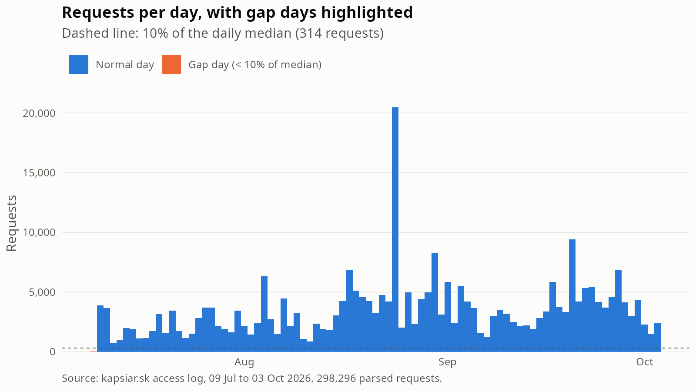
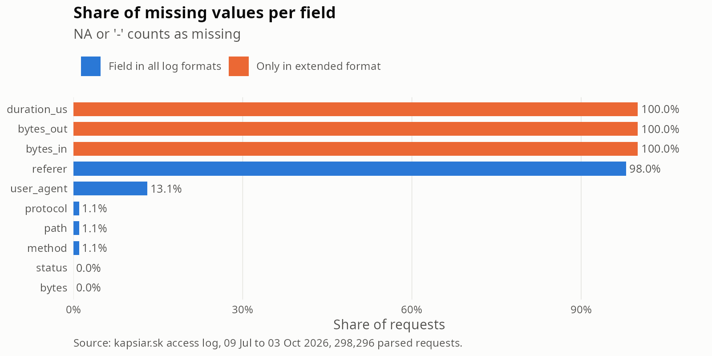

# Data quality: kapsiar.sk access logs

Generated by `analysis/data_quality.R` on 21 October 2026. Aggregates only.

Dataset: `data/processed/requests.rds` (298,296 parsed requests) and `data/processed/errors.rds` (44,530 error-log lines). Client IPs are replaced by a hash (`ip_hash`) during import.

## 1. Coverage

The requests span 09 July 2026 to 03 October 2026 (UTC), a calendar range of 87 days. 0 of these days have zero requests. 1 day(s) fall below 10% of the median: 09 Jul (25 requests).

Requests per day: median 3,135, interquartile range 1,934 to 4,228, maximum 20,486 (on 24 Aug 2026). A further 12 day(s) lie between 10% and 50% of the median.

The first and last day of the range are usually partial (container created or log fetched during the day), so they can appear as low days without being outages.

*Figure 7. Requests per day. Orange bars are gap days (fewer than 10% of the median daily count); the dashed line marks that threshold.*

## 2. Malformed and unparsable lines

`requests.rds` only holds rows that the access-log parser accepted (rows with `parse_ok == FALSE`: 0). Log lines that did not match the Apache format at all were dropped during import. Their count is not stored in the processed data, so it is a limitation of this report; `data-raw/import_logs.R` prints it at import time.

Requests whose request line was not valid HTTP (`probe_family == "malformed"`) are kept: 3,143 requests, 1.05% of all parsed requests. They carry no method or path.

Requests by probe family (families, not individual paths):

| Probe family | Requests | Share |
|---|---|---|
| none | 98,793 | 33.1% |
| php_probe | 48,011 | 16.1% |
| env | 47,961 | 16.1% |
| vcs | 26,158 | 8.8% |
| config_leak | 25,314 | 8.5% |
| wordpress | 21,103 | 7.1% |
| app_probe | 11,680 | 3.9% |
| device_exploit | 7,314 | 2.5% |
| backup | 4,079 | 1.4% |
| malformed | 3,143 | 1.1% |
| admin_panel | 2,874 | 1.0% |
| proxy | 1,866 | 0.6% |

## 3. Missingness per field

A value counts as missing if it is `NA` or the Apache placeholder `-` (or an empty string).

| Field | NA | '-' or empty | Missing | Share | Type |
|---|---|---|---|---|---|
| method | 3,143 | 0 | 3,143 | 1.05% | incidental |
| path | 3,143 | 0 | 3,143 | 1.05% | incidental |
| protocol | 3,148 | 0 | 3,148 | 1.06% | incidental |
| status | 0 | 0 | 0 | 0.00% | incidental |
| bytes | 0 | 0 | 0 | 0.00% | incidental |
| referer | 292,290 | 2 | 292,292 | 97.99% | incidental |
| user_agent | 39,018 | 0 | 39,018 | 13.08% | incidental |
| bytes_in | 298,296 | 0 | 298,296 | 100.00% | structural |
| bytes_out | 298,296 | 0 | 298,296 | 100.00% | structural |
| duration_us | 298,296 | 0 | 298,296 | 100.00% | structural |

*Figure 8. Share of missing values per field. Orange bars mark fields that exist only in the extended log format.*

`bytes_in`, `bytes_out` and `duration_us` are structurally missing. They come from the `%I %O %D` directives of the extended log format, which the server uses only from 7 October 2026. This dataset ends before that date, so these fields are 100% missing by design and not a data error. `method` and `path` are missing exactly for the malformed request lines (section 2); `protocol` is missing for those plus a handful of other rows with an incomplete request line. `referer` and `user_agent` are `NA` where the client sent `-` (the parser converts the Apache placeholder to `NA`), so a missing referer (about 98%) mostly means direct or script traffic, and a missing user agent (about 13%) means the client sent none. `status` and `bytes` are always present (responses without a body are logged with 0 bytes, 420 rows here).

## 4. Duplicates and clock

Exact duplicates (same `ip_hash`, `time`, `request`, `status` and `bytes`): 3,937 surplus rows (1.320% of requests), in 1,548 distinct duplicated keys covering 5,485 rows in total. Apache logs time at one-second resolution, so a duplicate can be a genuine repeated request within the same second (for example a client fetching the same resource twice) rather than a logging error. The rows are kept in the data.

Duplicated rows by probe family:

| Probe family | Rows |
|---|---|
| php_probe | 1,964 |
| none | 993 |
| malformed | 906 |
| admin_panel | 262 |
| vcs | 258 |
| device_exploit | 239 |
| wordpress | 223 |
| config_leak | 185 |
| proxy | 172 |
| env | 171 |
| app_probe | 106 |
| backup | 6 |

Timezone: `time` carries the tzone attribute `UTC`, `received` carries `UTC`, so all timestamps are UTC. Missing timestamps: 0. Rows are not stored in timestamp order (Apache writes the time when a request starts, so lines of slow requests can appear after later ones).

`received` is the time Docker received the line; `time` is the time Apache logged for the request. The difference `received - time` (seconds) over 298,296 rows: minimum 0.0, median 0.5, 99th percentile 1.0, maximum 3267.0. 0 rows are negative and 11 rows differ by more than 60 seconds.

## 5. Known blind spots

- **No incoming bytes.** `bytes_in` is absent before the format change on 7 October 2026, so request sizes and upload volume cannot be analysed (this limits KAP-54).
- **Cloudflare.** 55.8% of requests (166,527 of 298,296) carry a Cloudflare edge address instead of the visitor's (`via_cloudflare == TRUE`; 0 rows undetermined). Per-client statistics, such as requests per IP, are only valid for the remaining direct-to-origin traffic (12,422 distinct hashed addresses overall, mixing both kinds).
- **Start of the data.** Nothing exists before the web container was created on 9 July 2026. The first request in the dataset is on 09 July 2026.
- **Historical logs.** Logs from June 2025 to May 2026 exist only in a local-only backup and are not part of this dataset (KAP-104).
- **Dropped lines.** The count of unparsable log lines is not preserved (section 2).
- **Server-side only.** The logs show requests, not people: there is no session or user identifier, and user agents can be forged.

## 6. Error log

`errors.rds` holds 44,530 lines (Apache error log, stderr) from 09 Jul 2026 to 03 Oct 2026. Lines per day over the 87 calendar days in that range: median 492, interquartile range 182 to 800, maximum 1,830 (on 24 Aug 2026). Only the volume is described here; the content of the error log is analysed separately (KAP-71).

## Implications for the analysis

- Daily trends are reliable over the covered range; treat the 1 gap day(s) and the partial first and last day as missing data, not as zero traffic.
- Do not use `bytes_in`, `bytes_out` or `duration_us`; use `bytes` (outgoing body bytes) for volume.
- Per-client statistics (requests per IP, session-like features) hold only for direct traffic; 56% of requests come via Cloudflare and need a separate treatment until `CF-Connecting-IP` is logged.
- Keep malformed requests as their own probe family instead of dropping them; they have no method, path or protocol.
- Exact duplicates are plausible same-second repeats, so they are not removed.
- Conclusions cover 9 July 2026 onwards only; earlier history needs the local backup (KAP-104).

