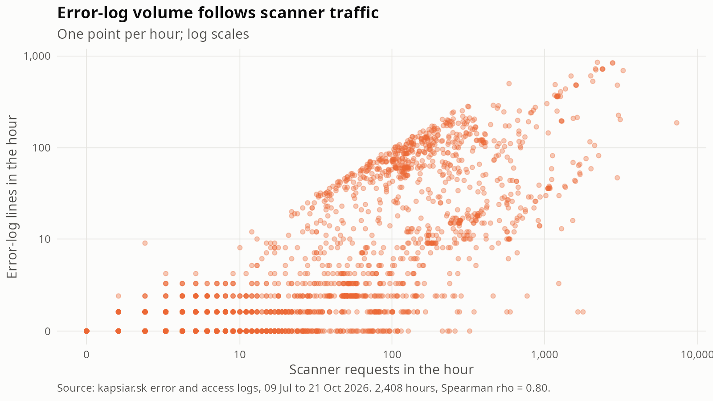

# Error-log summary (KAP-71)

Generated by `analysis/error_log.R`. Aggregates only: client addresses are dropped by `parse_error_log()` and templates are IPv4-masked.

## Overview

- Error lines: 68,333, from 2026-07-09 to 2026-10-21 (UTC).
- Parse rate: 68,333 of 68,333 lines (100.00%). Unparsed: 0.
- Distinct message templates: 14.

## Lines per day

| Statistic | Value |
|---|---|
| Days with errors | 103 |
| Mean | 663 |
| Median | 506 |
| Max | 7,562 |
| Busiest day | 2026-10-14 (7,562) |

## By module and level

| Module | Lines | Share |
|---|---|---|
| php | 49,291 | 72.1% |
| authz_core | 17,782 | 26.0% |
| core | 829 | 1.2% |
| autoindex | 401 | 0.6% |
| mpm_prefork | 18 | 0.0% |
| (none) | 12 | 0.0% |

| Level | Lines | Share |
|---|---|---|
| error | 68,296 | 99.9% |
| notice | 25 | 0.0% |
| (none) | 12 | 0.0% |

| Module | Level | Lines |
|---|---|---|
| php | error | 49,291 |
| authz_core | error | 17,782 |
| core | error | 820 |
| autoindex | error | 401 |
| mpm_prefork | notice | 16 |
| (none) | (none) | 12 |
| core | notice | 9 |
| mpm_prefork | error | 2 |

## PHP error types

No line carries a `PHP <type>:` prefix. All 49,291 `php` module lines are "script not found" errors, which Apache's mod_php emits without a type.

## Top message templates (>= 5 occurrences)

| Template | Lines | Share |
|---|---|---|
| `script <s> not found or unable to stat` | 49,291 | 72.1% |
| `client denied by server configuration: <path>` | 17,311 | 25.3% |
| `invalid URI path (<path>)` | 820 | 1.2% |
| `client denied by server configuration: <path>::$DATA` | 451 | 0.7% |
| `Cannot serve directory <path>: No matching DirectoryIndex (index.php,index.html) found, and server-generated directory index forbidden by Options directive` | 401 | 0.6% |
| `apache<n>: Could not reliably determine the server's fully qualified domain name, using <ip>. Set the <s> directive globally to suppress this message` | 12 | 0.0% |
| `client denied by server configuration: <path>;` | 10 | 0.0% |
| `Apache/<n>.<n>.<n> (Debian) PHP/<n>.<n>.<n> configured -- resuming normal operations` | 9 | 0.0% |
| `Command line: <s>` | 9 | 0.0% |
| `client denied by server configuration: <path> > div` | 8 | 0.0% |
| `caught SIGWINCH, shutting down gracefully` | 5 | 0.0% |

## Errors vs. scanner requests (per hour)

- Hours compared: 2,408 (hours with at least one access-log request).
- Spearman correlation, all hours: **0.80**.
- Spearman correlation, only hours with scanner requests or error lines: 0.80 (2,359 hours).
- Hours with error lines: 1,517; hours with scanner requests: 2,359.

## Real site bugs

No error template points at the site's own files (`/var/www/html/index.php`, `phpContent/`). No PHP warnings, notices or fatal errors from the site's code appear in the log.
The only PHP-related errors are `script ... not found or unable to stat` (49,291 lines): requests for PHP files that do not exist, i.e. probes, not bugs in the site.

## Implications

- The error log is almost entirely scanner noise: 99.94% of the lines are PHP "script not found", denied-by-config, invalid-URI or directory-listing errors triggered by probes.
- Error-line volume can serve as a second, independent scanner signal next to the path-based `probe_family()` rules. Hours where scanners hit PHP files show up as `script not found` bursts.
- `mpm_prefork` `MaxRequestWorkers` errors (a handful of lines) show scanner floods can exhaust Apache workers; worth watching if bursts grow.
- The summary drops client addresses, so errors cannot be attributed per client; use the access log for that.
- Because errors from probes dominate, alerting on raw error counts is useless; alert on new templates or on `php` warnings from the site's own files instead.

