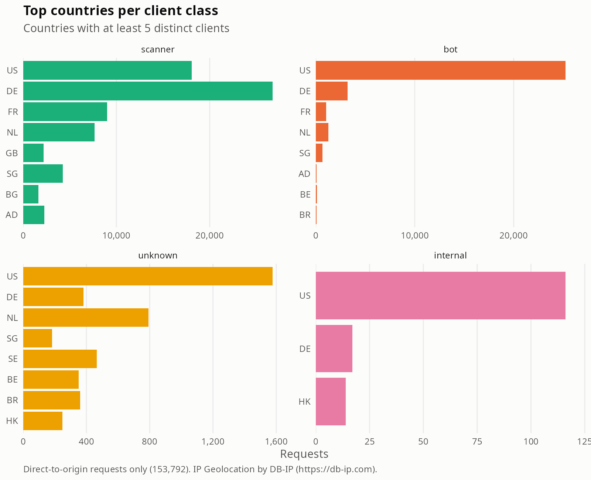
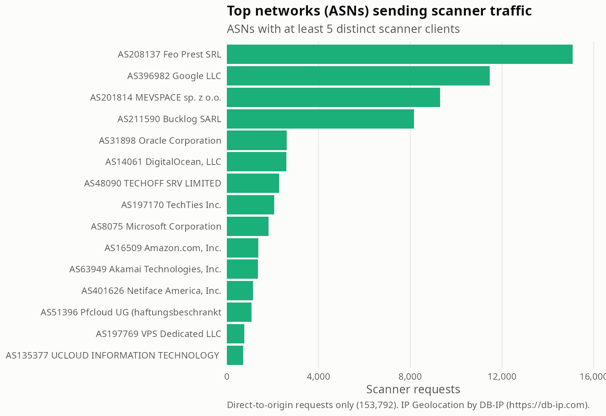

# Where scanners come from: country and ASN (KAP-72)

*IP Geolocation by DB-IP (https://db-ip.com).* Data: DB-IP Lite country and ASN databases (CC BY 4.0), looked up on the real IP inside `anonymise_requests()` before hashing.

## Scope

- Only direct-to-origin requests (`via_cloudflare == FALSE`): 153,792 requests, 4,662 distinct clients. Requests through Cloudflare carry an edge address, so country and ASN are `NA` there.
- Only countries and ASNs with at least 5 distinct clients are listed. Aggregates only.
- Geolocation is approximate (country level); an ASN identifies the network operator, not the person.

## Client class by hosting provider

Hosting/cloud = the AS organisation name matches one of these keywords (case-insensitive): 
amazon, google, microsoft, digitalocean, digital ocean, ovh, hetzner, linode, akamai, alibaba, tencent, contabo, m247, vultr, choopa, oracle, cloud, hosting, datacamp, leaseweb, scaleway, online s.a.s, ionos, stark industries, pq hosting, kamatera, colocrossing, psychz.
The list is a heuristic: broad words like `cloud` or `hosting` also catch some non-hosting networks, and VPN or proxy providers outside the list are missed.

| class | requests | clients | requests from hosting ASNs | clients in hosting ASNs |
|---|---|---|---|---|
| scanner | 85,217 | 3,201 | 29% | 48% |
| bot | 39,290 | 671 | 24% | 67% |
| internal | 23,730 | 119 | 0% | 0% |
| unknown | 5,555 | 1,621 | 45% | 63% |

**Scanners: 29% of scanner requests and 48% of scanner clients sit in hosting/cloud ASNs.**

## Top countries of scanner traffic

| country | requests | clients | share |
|---|---|---|---|
| DE | 26,762 | 518 | 31.4% |
| US | 18,089 | 1,259 | 21.2% |
| FR | 8,988 | 105 | 10.5% |
| NL | 7,640 | 213 | 9.0% |
| SG | 4,272 | 60 | 5.0% |
| AD | 2,289 | 23 | 2.7% |
| GB | 2,200 | 209 | 2.6% |
| BG | 1,620 | 7 | 1.9% |
| VN | 1,035 | 38 | 1.2% |
| HK | 1,003 | 63 | 1.2% |

## Top ASNs of scanner traffic

| asn | organisation | requests | clients | hosting |
|---|---|---|---|---|
| AS208137 | Feo Prest SRL | 15,075 | 9 | no |
| AS396982 | Google LLC | 11,471 | 448 | yes |
| AS201814 | MEVSPACE sp. z o.o. | 9,296 | 10 | no |
| AS211590 | Bucklog SARL | 8,162 | 9 | no |
| AS31898 | Oracle Corporation | 2,613 | 19 | yes |
| AS14061 | DigitalOcean, LLC | 2,598 | 253 | yes |
| AS48090 | TECHOFF SRV LIMITED | 2,289 | 23 | no |
| AS197170 | TechTies Inc. | 2,063 | 39 | no |
| AS8075 | Microsoft Corporation | 1,824 | 402 | yes |
| AS16509 | Amazon.com, Inc. | 1,376 | 15 | yes |
| AS63949 | Akamai Technologies, Inc. | 1,355 | 80 | yes |
| AS401626 | Netiface America, Inc. | 1,139 | 10 | no |
| AS51396 | Pfcloud UG (haftungsbeschrankt) | 1,077 | 39 | yes |
| AS197769 | VPS Dedicated LLC | 769 | 21 | no |
| AS135377 | UCLOUD INFORMATION TECHNOLOGY (HK) LIMITED | 710 | 61 | yes |

