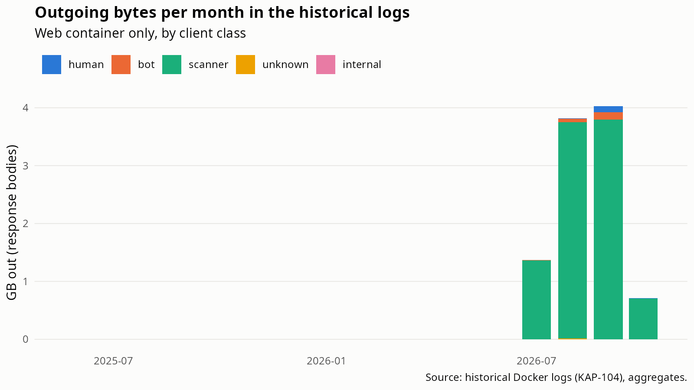
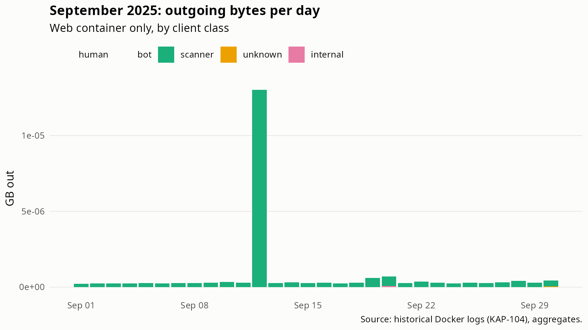

# Historical logs: June 2025 to May 2026 (KAP-104)

Generated by `analysis/history_summary.R` on 2026-10-22 from `data/processed/history`. Aggregates only. The raw backup is local-only: it was streamed by `data-raw/import_history.R` in a scheduled run on Peter's PC, no AI tool read it, and the outputs were checked for IPs, paths and e-mail addresses before use.

## Files

| File | Lines | stdout | stderr | Apache share of stdout | From | To | Role |
|---|---|---|---|---|---|---|---|
| container_7351262c6c23-json.log | 22,493,977 |         0 | 22,493,975 | 0.0% | NA | NA | other |
| container_d653e38fe035-json.log |  5,863,190 | 5,862,792 |        396 | 0.0% | NA | NA | other |
| container_331fe250f051-json.log |    355,936 |   309,346 |     46,590 | 100.0% | 2026-07-09 | 2026-10-07 | web |
| container_bc690daf9b31-json.log |    163,347 |     1,395 |    161,952 | 0.0% | NA | NA | other |
| container_e685adc07a2c-json.log |     21,473 |    21,233 |        240 | 100.0% | 2025-06-12 | 2026-05-14 | web |

Files with role `web` (at least half of the stdout lines are Apache requests) are used below: container_331fe250f051-json.log, container_e685adc07a2c-json.log.

Files with role `other` were written by other services on the same server, not by Apache. Their line formats were identified from masked skeletons (every letter run replaced by `a`, every digit run by `9`), so no content was read. See `analysis/history_other_services.md`.

## Monthly volume (web container)

| Month | Requests | MB out |
|---|---|---|
| 2025-06 |      16 |     0.0 |
| 2025-08 |     164 |     0.0 |
| 2025-09 |     848 |     0.0 |
| 2025-10 |     430 |     0.0 |
| 2025-11 |     570 |     0.0 |
| 2025-12 |   1,018 |     0.0 |
| 2026-01 |     980 |     0.0 |
| 2026-02 |   1,085 |     0.0 |
| 2026-03 |   1,820 |     0.0 |
| 2026-04 |   6,195 |     0.1 |
| 2026-05 |   8,107 |     0.1 |
| 2026-07 |  49,259 | 1,369.3 |
| 2026-08 | 125,448 | 3,816.2 |
| 2026-09 | 117,374 | 4,024.1 |
| 2026-10 |  17,265 |   707.8 |

*Figure 10. Outgoing response bytes per month in the historical logs, by client class.*

## September 2025

The pitch cited 64.3 GB incoming and 5.2 GB outgoing in 09/2025 (hosting-provider counters). The access log records outgoing response bodies only (`%b`); these logs have no incoming bytes. Logged outgoing volume in September 2025: **0.02 MB** over 848 requests.

By client class:

| Class | Requests | KB out | Share of bytes |
|---|---|---|---|
| scanner | 842 | 22.1 | 99.5% |
| internal |   5 |  0.1 | 0.3% |
| unknown |   1 |  0.0 | 0.2% |

Top 10 days by outgoing bytes:

| Day | Requests | KB out |
|---|---|---|
| 2025-09-12 | 601 | 13.0 |
| 2025-09-20 |  32 |  0.7 |
| 2025-09-19 |  15 |  0.6 |
| 2025-09-30 |  12 |  0.4 |
| 2025-09-28 |  11 |  0.4 |
| 2025-09-22 |  10 |  0.4 |
| 2025-09-10 |   9 |  0.3 |
| 2025-09-14 |   8 |  0.3 |
| 2025-09-27 |   8 |  0.3 |
| 2025-09-09 |   7 |  0.3 |

Requests by probe family:

| Family | Requests | Share |
|---|---|---|
| malformed | 508 | 59.9% |
| none | 291 | 34.3% |
| admin_panel |  36 | 4.2% |
| php_probe |   8 | 0.9% |
| app_probe |   2 | 0.2% |
| backup |   2 | 0.2% |
| vcs |   1 | 0.1% |

*Figure 11. Outgoing response bytes per day in September 2025, by client class.*

## Caveats

- Classification ran per chunk of the stream, so per-client rules (bursts, 404 ratio) can be slightly off at chunk boundaries. Totals, bytes, status and probe families are exact.
- The old logs have no `CF-Connecting-IP` and no `%I`, so incoming volume is not visible and the human class may be under-counted (it requires Cloudflare-proxied browser traffic).
- Response sizes count bodies only (`%b`), not headers or TLS overhead, so logged outgoing bytes are a lower bound of the provider's outgoing counter.

