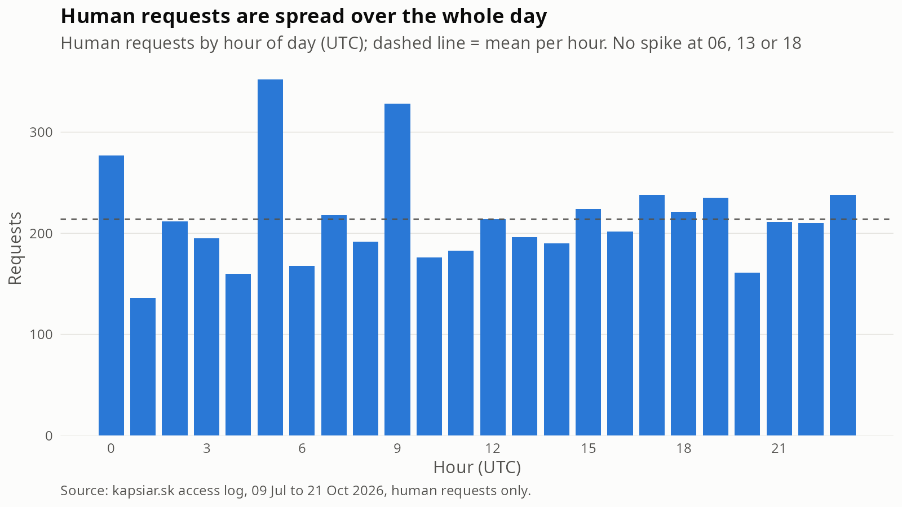
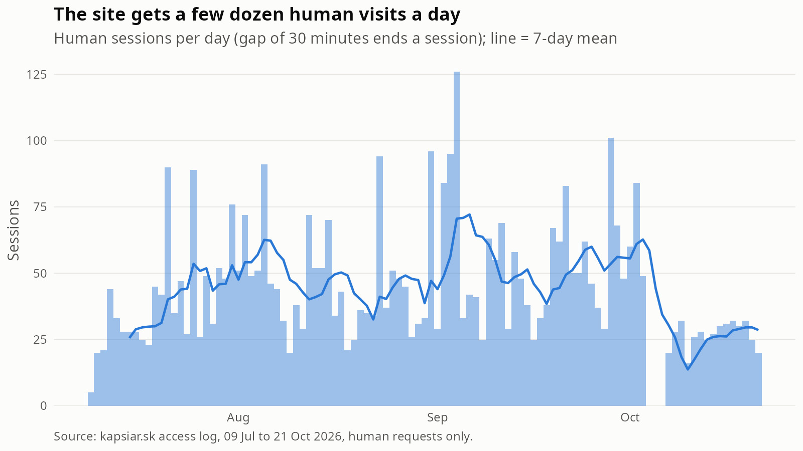

# The human audience of kapsiar.sk

Generated by `analysis/human_audience.R` on 2026-10-22. Aggregates only (KAP-70).

## Dataset

- 395,121 requests from 09 Jul to 21 Oct 2026 (105 days, UTC). 5,137 requests (1.3%) are classified as human.
- Human means a browser user agent on a request that came through Cloudflare (see `classify_requests()`). All of them are Cloudflare requests, so the address in the log is a shared edge address; sessions are approximate.
- 3,281 distinct clients (ip_hash plus user agent). 17.0% of them were seen on more than one day.

## Are scheduled monitors hiding in the human class?

An earlier figure (`05_hour_of_day_by_class.png`) showed human hits peaking at 06, 13 and 18 UTC, which looked like uptime monitors with browser user agents. I checked this with the current classifier.

- Share of human requests in hours 06, 13 and 18: 11.4%. A flat distribution would give 12.5%. The spike is gone.
- Busiest hours: 05, 09, 00 (352, 328, 277 requests); quietest: 01, 04, 20 (136, 160, 161). The mean is 214 per hour. The counts are not perfectly uniform (chi-square p < 0.001), but no hour stands out the way 06, 13 and 18 did.
- Clients whose requests fall at least 80% in the same minute of the hour, on at least 5 days: **0** of 91 clients active on 5 or more days (0 of 86 when only page loads of `/` are used; 8 when the test is loosened to 50% on 3 days).

Conclusion: with the current rules and data there are no fixed-minute monitors left in the human class, so I do not propose a classifier change. I did not check which earlier rules produced the spike; the data now shows none. If monitors with browser user agents come back, the test above (same minute of the hour on 5 or more days, at least 80% of a client's human requests) is the rule I would add to `classify_requests()`.

## Visits per day

A session is a run of requests from one client (ip_hash and user agent) without a gap of 30 minutes or more, counted on the day it starts (`sessions_per_day()`).

- Median **38 sessions per day** (mean 43.8, range 0 to 126) over 105 days; 3 days had no human session.
- 4,599 sessions in total, from a median of 37 distinct clients per day.
- A median session has 1 request. 94.5% of sessions are a single request, and 72.2% of sessions contain a request for `/`. Sessions with more than one request (5.5% of all) have a median of 2 requests and 0.4 minutes between first and last request.

## Pages

Only real site paths are counted (`/`, `/index.php` and the PHP content files), not scripts, styles or the favicon. They account for 72.6% of the 5,137 human requests. The site is a single page (KAP-112), so `/` dominates.

| path | requests | share |
|---|---|---|
| / | 3,623 | 97.4% |
| /phpContent/aboutMe.php | 39 | 1.0% |
| /phpContent/landingPageContent.php | 37 | 1.0% |
| /index.php | 22 | 0.6% |

## Referrers

Referrer host of the 3,623 human page loads of `/`: 95.3% have no referrer (typed address, bookmark, or a browser or app that strips it) and 2.7% come from the site itself. Hosts with at least 5 page loads:

| host | page_loads | share |
|---|---|---|
| www.google.com | 18 | 24.7% |
| five.co.in | 9 | 12.3% |
| bing.com | 5 | 6.8% |
| www.bing.com | 5 | 6.8% |

The share column is of the page loads that have an external referrer.

## Devices and browsers

Based on the 3,623 human page loads of `/`. Mobile means the user agent contains Mobile, Android, iPhone or iPad.

| group | page_loads | share |
|---|---|---|
| desktop | 2,086 | 57.6% |
| mobile | 1,537 | 42.4% |

| group | page_loads | share |
|---|---|---|
| Chrome | 1,823 | 50.3% |
| Firefox | 193 | 5.3% |
| Safari | 1,541 | 42.5% |
| Edge | 66 | 1.8% |
| other | 0 | 0.0% |

## Limits

- All human requests arrive through Cloudflare, so the logged address is an edge address shared between visitors. Two visitors with the same browser on the same edge can merge into one client, and one visitor can appear on several edges. Sessions are approximate, and probably an under-count.
- The human class only has browser user agents on non-probe paths. A person whose browser requested a missing file is classified as scanner (404 rule), and a person who reached the origin directly is classified as unknown; both are left out.
- A browser user agent can be faked; the 'human' label means 'looks like a normal browser visit', not proof of a person.
- The user-agent device and browser split is a simple regex and lumps all Chromium-based browsers other than Edge under Chrome.

## Implications

- The real audience is small: tens of sessions a day against thousands of scanner requests. Dashboard figures for humans should show sessions, not raw requests.
- Nothing needs to change in the human rule for monitors. Re-run the check in this script after the classifier changes.
- Referrers are mostly empty, so the dashboard should not promise an acquisition breakdown beyond a short list of hosts.
- `sessions_per_day()` is ready to export for the dashboard; it needs the Cloudflare caveat next to the number.
