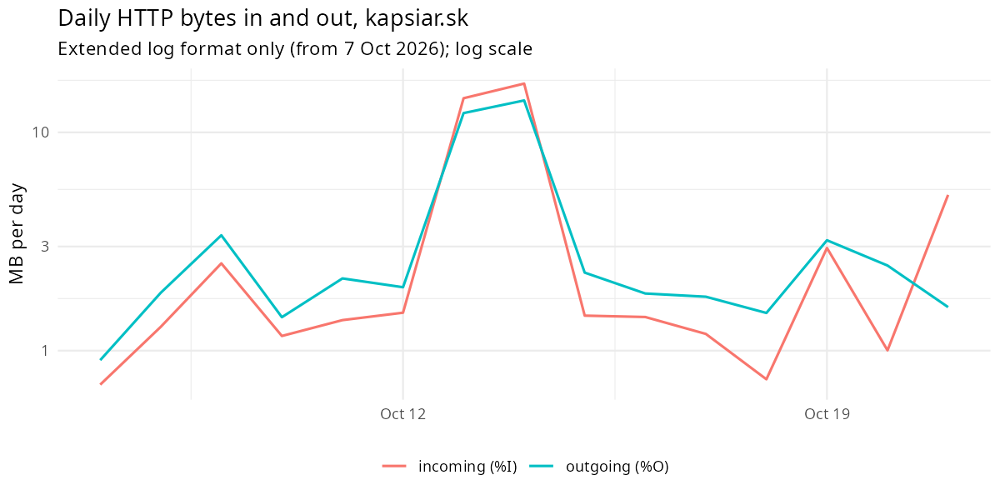

# Incoming vs outgoing HTTP traffic (KAP-54)

Generated by `analysis/incoming_outgoing.R`. Aggregates only.

## Question

The provider reported 64.3 GB incoming and 5.2 GB outgoing for 09/2025, an in/out ratio of 12.4. Nobody knows the source of that figure, so this analysis asks what today's HTTP traffic looks like with the `%I` (bytes received, including headers) and `%O` (bytes sent, including headers) fields, and whether HTTP traffic can produce a pattern like that.

## Data

- Requests with `%I`/`%O` (extended format, 2026-10-07 to 2026-10-21): 96,825 of 395,121 (15 days).
- `%I` and `%O` count the whole request and response on the wire (headers included), before TLS and without Cloudflare's own overhead; they are not the provider's network counters.
- Requests rejected before Apache logs a size have no value and are left out.

## Totals

- Incoming: **53.5 MB**; outgoing: **52.5 MB**.
- Ratio in/out: **1.020** (the provider's 09/2025 ratio: 12.4).
- Per day: median 1.4 MB in, 2.0 MB out; the day ratio ranges from 0.409 to 3.266.
- Per request: median 577 bytes in, 533 bytes out; 99th percentile of bytes in: 1,031; largest single request in: 1,055,006 bytes.

## By client class

| client_class | requests | MB in | MB out | ratio in/out | share of in | share of out | median bytes in | median bytes out |
|---|---|---|---|---|---|---|---|---|
| bot | 50,579 | 27.9 | 28.3 | 0.987 | 52.2% | 53.9% | 609 | 536 |
| scanner | 37,604 | 19.9 | 20.7 | 0.960 | 37.2% | 39.5% | 422 | 528 |
| internal | 6,874 | 0.7 | 0.9 | 0.761 | 1.2% | 1.7% | 97 | 126 |
| unknown | 1,093 | 4.6 | 1.1 | 4.023 | 8.5% | 2.2% | 297 | 616 |
| human | 675 | 0.4 | 1.4 | 0.310 | 0.8% | 2.8% | 683 | 620 |

## Probe families by bytes in

Top families of requests whose path is a probe (names are families, not paths).

| probe_family | requests | MB in | MB out | mean bytes in | share of all in |
|---|---|---|---|---|---|
| env | 25,157 | 14.48 | 13.29 | 575 | 27.1% |
| config_leak | 8,459 | 4.93 | 4.46 | 583 | 9.2% |
| app_probe | 5,307 | 4.09 | 2.80 | 769 | 7.6% |
| php_probe | 7,662 | 3.55 | 4.00 | 463 | 6.6% |
| wordpress | 2,325 | 1.42 | 1.22 | 611 | 2.7% |
| admin_panel | 1,493 | 0.85 | 0.79 | 567 | 1.6% |
| device_exploit | 1,414 | 0.65 | 0.75 | 460 | 1.2% |
| vcs | 1,133 | 0.54 | 0.59 | 473 | 1.0% |

## Response time (`%D`, per request)

| client_class | requests | median ms | p95 ms |
|---|---|---|---|
| bot | 50,579 | 0.39 | 3.44 |
| scanner | 37,604 | 0.37 | 1.81 |
| internal | 6,874 | 0.17 | 0.55 |
| unknown | 1,093 | 1.89 | 7.33 |
| human | 675 | 2.00 | 7.44 |

## Conclusion

- Today's HTTP in/out ratio is 1.02, against 12.4 for the provider's 09/2025 figure: about 12 times lower. Incoming and outgoing bytes are almost equal, because most requests come from bots and scanners that get a short page or error back (about 500 bytes each way).
- HTTP requests bring in 53.5 MB over 15 days, about 3.6 MB per day. The provider's 64.3 GB in one month is about 2,143 MB per day, 601 times that.
- Only 5 of 96,825 requests send more than 10 KB in (the largest is 1,055,006 bytes); the 99th percentile is 1,031 bytes. The only classes with more bytes in than out are small (unknown: ratio 4.0, 1,093 requests) and cannot matter at the scale of gigabytes.
- A ratio of 12 needs about 12 times more bytes received than sent. With HTTP to this site that would take sustained large request bodies (uploads), and the logs show almost none. Today's HTTP traffic cannot produce that pattern.
- This supports the earlier finding in `analysis/history_other_services.md`: the 09/2025 spike was not HTTP traffic to kapsiar.sk. Another service on the VPS (or non-HTTP traffic) is the likely source. Proving it needs the provider's per-day graph or per-service counters.

Limits: only 7 Oct to 21 Oct 2026 has `%I`/`%O`; September 2025 has no byte fields at all, so this is a comparison of patterns, not a measurement of that month. Scanners downloading `.git` objects stopped after the KAP-68 fix, so outgoing bytes are lower now than before.
