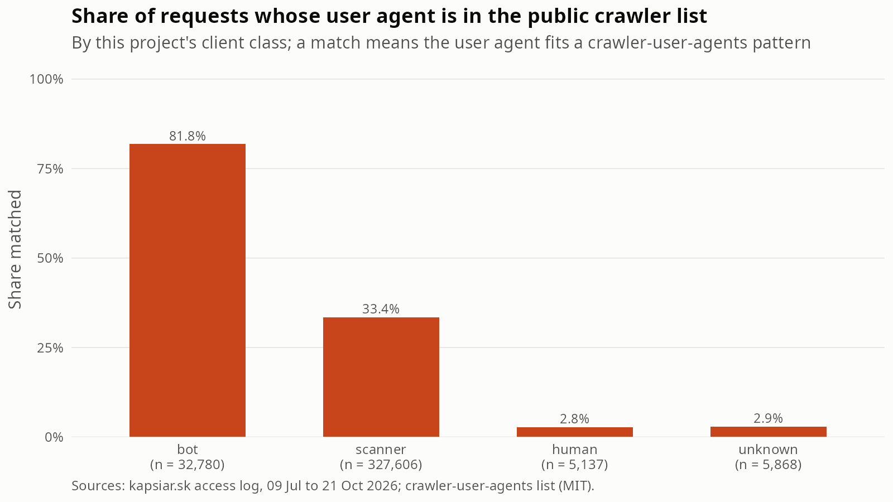
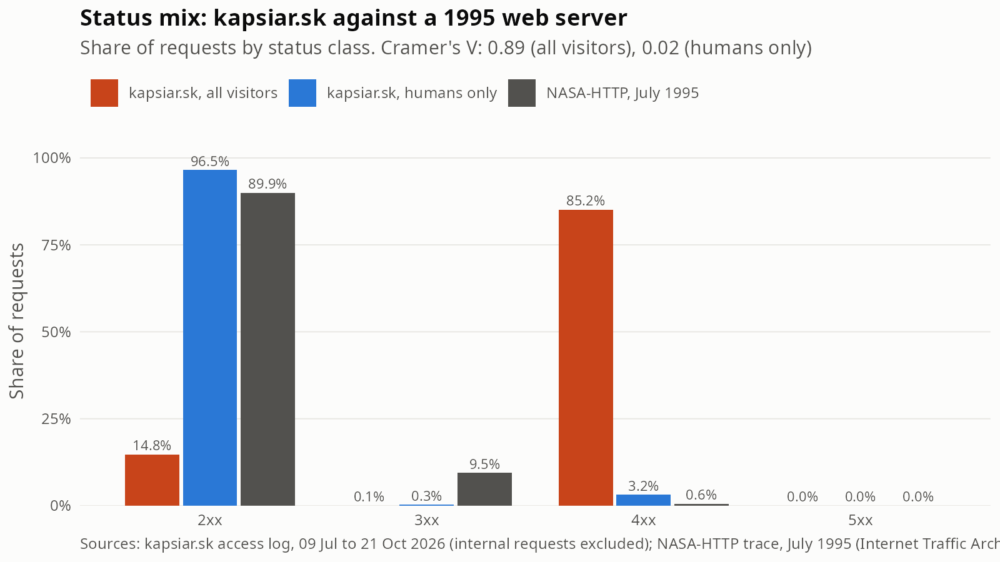
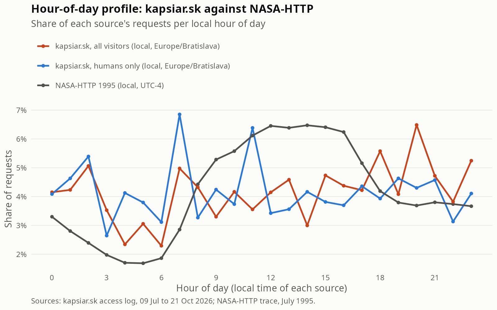

# Public comparison (KAP-64, RQ3)

kapsiar.sk access log, 09 Jul to 21 Oct 2026: 371,391 requests from visitors (internal requests excluded), of which 5,137 from humans. Aggregates only; the public files are downloaded to a git-ignored folder and are not part of the repository.

## Sources

| Source | What was used | Licence or conditions | Attribution |
|---|---|---|---|
| Cloudflare Radar, "The 2025 Cloudflare Radar Year in Review" (blog.cloudflare.com/radar-2025-year-in-review/, published 15 Dec 2025) | One published figure: the human share of HTML requests on 2 Dec 2025 | Published article. The Radar API itself is CC BY-NC 4.0 and needs a token, which this project does not have, so no API data was used | Cloudflare, Inc. |
| crawler-user-agents (github.com/monperrus/crawler-user-agents), file `crawler-user-agents.json`, downloaded 22 Oct 2026 from raw.githubusercontent.com/monperrus/crawler-user-agents/master/crawler-user-agents.json | The `pattern` field of each entry (regular expressions): the file has 1,501 entries | MIT | The repository's copyright holders (GitHub user monperrus and contributors) |
| NASA-HTTP, Internet Traffic Archive (ita.ee.lbl.gov/html/contrib/NASA-HTTP.html), file `NASA_access_log_Jul95.gz`, downloaded 22 Oct 2026 from ftp://ita.ee.lbl.gov/traces/NASA_access_log_Jul95.gz | All requests of 1-28 July 1995 | The archive page states under Restrictions: "The traces may be freely redistributed." It also states under Privacy: "Please do not however attempt any analysis beyond general traffic patterns." This report stays at the level of aggregate status and hourly shares | Trace collected by Jim Dumoulin of the Kennedy Space Center and contributed by Martin Arlitt and Carey Williamson of the University of Saskatchewan |

The NASA file holds 1,891,715 lines. 15 did not match the log pattern (a stray quote in the request) and are left out; the log's own times are in UTC-4. The archive page describes the file as July 1 to July 31; the last request in the file is on 28 July, so the file covers 28 days.

## Automated share vs Cloudflare

Cloudflare's 2025 Year in Review states (HTML requests across its customer base, "as of December 2, human traffic generated 47% of HTML requests, and non-AI bots generated 44%"). The article notes that these shares are for HTML content only and differ from the all-content shares on Radar. Taking everything that is not human as automated gives about 53%; this subtraction is mine, not a figure Cloudflare publishes. The same article reports that AI bots made up 4.2% of HTML requests on average over 2025 and that Googlebot alone made up 4.5%.

| Measure | Share |
|---|---|
| kapsiar.sk: bot + scanner | 97.0% |
| kapsiar.sk: bot only | 8.8% |
| kapsiar.sk: scanner only | 88.2% |
| kapsiar.sk: human | 1.4% |
| kapsiar.sk: unknown | 1.6% |
| Cloudflare: human (HTML requests, 2 Dec 2025) | 47.0% |
| Cloudflare: not human, derived (HTML requests) | 53.0% |

The kapsiar.sk automated share is 97.0%, which is 44.0 percentage points above the derived Cloudflare figure; the human share is 45.6 points below. The two numbers are a single reference point against a whole period, not a time series. The definitions differ (see Limitations).

## Bot UA coverage

Each request's user agent was matched against the 1,501 patterns of the crawler list (case-sensitive, PCRE). A match means the user agent fits a known crawler pattern; it does not say the request was wanted or harmless.

| Client class | Requests | Matched by list | Share |
|---|---|---|---|
| bot | 32,780 | 26,824 | 81.8% |
| scanner | 327,606 | 109,514 | 33.4% |
| human | 5,137 | 142 | 2.8% |
| unknown | 5,868 | 170 | 2.9% |

- Of the 32,780 requests classified bot, 26,824 (81.8%) have a user agent in the list. 900 of the bot requests carry no user agent at all and cannot match; among bot requests that do send one the share is 84.1%.
- Disagreement the other way: 109,514 of the 327,606 scanner requests (33.4%) also match the list. Most come from declared crawlers and generic HTTP clients that requested probe paths, so the classifier's scanner rule (which runs before the bot rule) puts them in the scanner class.
- Human requests matching the list: 142 of 5,137 (2.8%). Unknown: 170 of 5,868 (2.9%).

Top 10 user-agent families of bot requests that the list does not match (versions stripped; families with at least 5 requests):

| UA family | Requests |
|---|---|
| Chrome | 4,497 |
| Safari | 177 |
| Edge | 51 |
| jscrawler | 29 |
| Firefox | 23 |
| Reflectionbot | 17 |
| Meta-ExternalAgent | 15 |
| GrokBot | 12 |
| Meta-ExternalFetcher | 12 |
| MoonshotBot | 12 |

Scanner requests that the list does match, by family (top families with at least 5 requests):

| UA family | Requests |
|---|---|
| Googlebot | 29,225 |
| curl | 19,950 |
| meta-externalagent | 8,175 |
| CCBot | 4,678 |
| Go-http-client | 4,168 |
| ChatGPT-User | 2,751 |

## Status mix vs NASA

| group | 2xx | 3xx | 4xx | 5xx |
|---|---|---|---|---|
| kapsiar.sk, all visitors | 14.8% (54,856) | 0.1% (228) | 85.2% (316,307) | 0.0% (0) |
| kapsiar.sk, humans only | 96.5% (4,958) | 0.3% (14) | 3.2% (165) | 0.0% (0) |
| NASA-HTTP, July 1995 | 89.9% (1,701,534) | 9.5% (179,200) | 0.6% (10,890) | 0.0% (76) |

Share of 4xx: kapsiar.sk 85.2% for all visitors and 3.2% for humans only; NASA-HTTP 0.6%. No 1xx responses occur in any of the three groups.

| Comparison | Chi-squared (df = 3) | p-value | Cramer's V |
|---|---|---|---|
| kapsiar.sk all visitors vs NASA | 1797282 | < 2.2e-16 | 0.89 |
| kapsiar.sk humans only vs NASA | 1095 | < 2.2e-16 | 0.02 |

With samples of this size (371,391, 5,137 and 1,891,700 requests) any difference is significant, so the p-values say little; Cramer's V is the effect size. V is 0.89 for all visitors, which is a very large difference, and 0.02 for humans only, which is small. The chi-squared test treats every request as independent, which logs violate (one client sends many requests), so the p-values are optimistic even before the sample-size issue.

## Hourly profile

Hour-of-day shares were computed in each source's local time (NASA UTC-4; kapsiar.sk Europe/Bratislava, which is where the site's owner and most human visitors are expected; this is an assumption, since the log has no visitor time zone) and, as a check, with both sources in UTC.

| Profile | Busiest hour | Busiest / quietest hour |
|---|---|---|
| NASA-HTTP 1995 (local) | 14:00 | 3.8 |
| kapsiar.sk, all visitors (local) | 20:00 | 2.8 |
| kapsiar.sk, humans only (local) | 07:00 | 2.6 |

| kapsiar.sk group | Pearson r, local clocks | Pearson r, both in UTC |
|---|---|---|
| all visitors | 0.17 | 0.40 |
| humans only | -0.01 | -0.12 |

NASA's 1995 profile has a clear working-day shape (busiest/quietest ratio 3.8). The kapsiar.sk all-visitor profile has a ratio of 2.8 and the human profile 2.6. Pearson r of the 24 shares is 0.17 for all visitors and -0.01 for humans only on local clocks, and 0.40 and -0.12 in UTC. Each correlation is based on 24 points, and the human profile rests on only 5,137 requests over 102 days.

Daily volume: NASA-HTTP has a median of 64,670 requests per day (28 days); kapsiar.sk has a median of 3,013 requests per day for all visitors and 46 for humans only (102 days with traffic).

## Limitations

- **Era.** NASA-HTTP is from 1995: HTTP/1.0, before today's scanners and AI crawlers. Differences reflect 31 years of web change as much as anything about kapsiar.sk.
- **Site type.** NASA ran a popular public information site with a staff audience in one time zone; kapsiar.sk is a personal site with a tiny audience, an exposed web root and mostly unwanted traffic. Neither is a sample of "the web".
- **Scale.** NASA's file has about 370 times as many requests as kapsiar.sk's human traffic. Only aggregate shapes are compared; client-level comparison makes no sense, and the NASA page asks users to stay with general traffic patterns.
- **Definitions.** Cloudflare classifies each request with its own bot score across its customer base and, in the figure used here, only for HTML requests. This project classifies by rules on paths, user agents and behaviour, over all content types. The crawler list matches user-agent strings only and says nothing about accuracy; a spoofed user agent matches, a crawler with a unique string does not. The classifier and the list are not independent: both use user-agent strings.
- **Cloudflare figure.** One published number for one date (2 Dec 2025), outside the kapsiar.sk period, read from an article; no time series, and the "not human" share is derived by subtraction.
- **Time zones.** kapsiar.sk hours are shown in Europe/Bratislava as an assumption about the audience; scanners run around the clock regardless.

## Implications

- RQ3: kapsiar.sk is far more automated than the public reference. About 97% of its requests are bot or scanner traffic, against roughly 53% non-human HTML requests reported by Cloudflare across its customers. The gap is large, but the definitions differ, so the direction is solid and the exact size is not.
- The status mix is the clearest contrast: 85% of requests to kapsiar.sk are 4xx against 0.6% at NASA, with V = 0.89. Probing for paths that do not exist produces that pattern; a clean public site does not. For humans alone the 4xx share is 3.2%, which is higher than NASA's 0.6% but only by a few percentage points.
- Classifier validation (RQ1): the public list recognises 81.8% of bot requests and 84.1% of those that send a user agent. The unmatched bot requests are mostly browser-like user agents that the classifier labelled bot by behaviour, which a user-agent list cannot confirm or refute. 33.4% of scanner requests match the list, which shows that the scanner rule overrides declared crawlers that request probe paths; whether such requests should be counted as bots or as scanners is a definition question for the report.
- The hourly comparison supports only a weak claim, because the human sample is small; see the correlations above.
